# Flujos de la web y de la atención ciudadana

> Hoy todo esto vive en la versión de prueba. Las solicitudes son inventadas. Ningún correo sale de la plataforma.

<!-- Escrito a mano desde el código, no desde los manuales: los estados y sus motivos salen de src/lib/domain/attention.ts y de supabase/migrations/20261106000200_participacion.sql; lo que hace la persona, de 20261106000300_citizen.sql y src/components/participation; los permisos de la web, de 20261106000110_web_publica.sql y src/lib/actions/web*.ts; el contenido real, de scripts/real-site y src/lib/db/seed-parts/web-real.ts. Si el código cambia, se cambia aquí. Cada diagrama se revisa para que quepa en una hoja A4 con la letra legible. -->

Cómo va cada cosa de la web pública y de la atención ciudadana. GitHub dibuja cada diagrama. Debajo de cada uno va lo que hay que saber. Los nombres de los botones están escritos tal como salen en la pantalla. El detalle de cada pantalla está en `MANUAL-ATENCION.md` y en `MANUAL-ADMIN-WEB.md`. Los flujos del panel están en `FLUJOS.md`.

- [Enviar una solicitud](#flujo-web-envio)
- [Consultar la solicitud](#flujo-web-consulta)
- [Una denuncia](#flujo-web-denuncia)
- [Un caso, de la bandeja al cierre](#flujo-web-caso)
- [Los estados: el camino de siempre](#flujo-web-estados)
- [Los estados: los desvíos](#flujo-web-desvios)
- [Casos iguales y apoyos](#flujo-web-iguales)
- [Spam](#flujo-web-spam)
- [Los correos que recibe la persona](#flujo-web-correos)
- [«Casos atendidos»](#flujo-web-atendidos)
- [Casos vencidos y sin movimiento](#flujo-web-avisos)
- [La web: escribir y enviar a aprobación](#flujo-web-contenido)
- [La web: revisar y decidir](#flujo-web-decidir)
- [La web: cambiar o quitar lo publicado](#flujo-web-arreglar)
- [Fotos y documentos](#flujo-web-fotos)
- [Ajustes del sitio](#flujo-web-ajustes)
- [Direcciones de la web vieja](#flujo-web-redirecciones)
- [El contenido real en la demo publicada](#flujo-web-real)

## Enviar una solicitud
Lo hace cualquier persona, sin cuenta, en «Atención ciudadana» (`/atencion/nueva`).

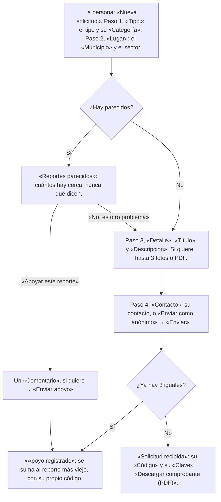

**Qué hay que saber**
- Los parecidos y el apoyo solo existen para un reporte. Quien apoya también recibe su código y su clave.
- Lo escrito se queda en esa pestaña. Si se va la señal, no se pierde. Tampoco se envía dos veces.
- La clave se muestra una sola vez. Nunca va por correo.
- Cada formulario avisa que esto no es un servicio de emergencias.

## Consultar la solicitud
Lo hace la persona con su código y su clave, en «Consultar mi solicitud» (`/atencion/consultar`).

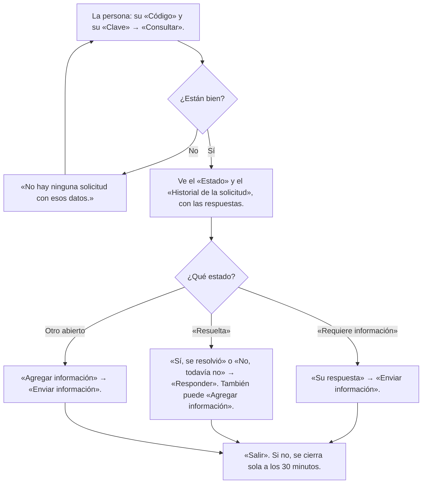

**Qué hay que saber**
- Dice lo mismo sea cual sea el error. Solo cuentan los intentos fallidos.
- Al responder lo que se le pidió, la solicitud vuelve a «En revisión». Con «No, todavía no», escribe «¿Qué falta por resolver?». La solicitud vuelve a «En atención».
- Nunca ve las notas internas ni el motivo de un cambio de estado. Tampoco ve quién del personal hizo cada cosa.
- Una solicitud «Cerrada» o «No procede» ya no recibe información. Quien apoyó un reporte ve solo su estado.

## Una denuncia
La envía cualquier persona, como las demás. La atienden solo el operador de denuncias y la coordinación.

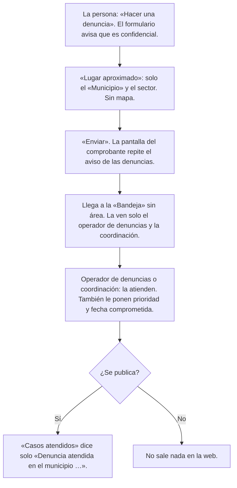

**Qué hay que saber**
- El jefe y auditoría solo la cuentan en los totales. Un responsable de área nunca la ve.
- Su contenido nunca se publica. Nunca va al mapa.
- Los correos a la persona nunca dicen «denuncia». La plataforma no avisa a ninguna autoridad.
- Si otra solicitud es en realidad una denuncia, la coordinación la corrige en «Corregir tipo o categoría». Pierde la ubicación exacta y sale de su área.

## Un caso, de la bandeja al cierre
Lo hacen la coordinación y los responsables de área, en «Atención» (`/admin/atencion`). En una denuncia, el operador de denuncias.

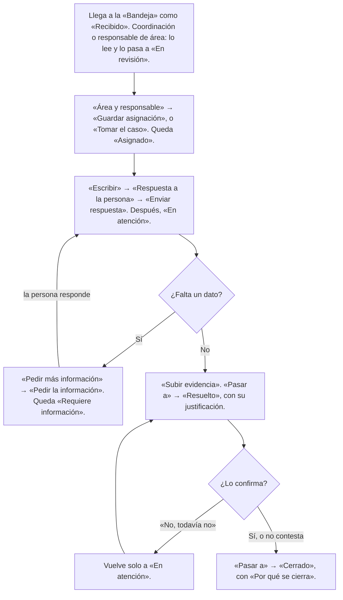

**Qué hay que saber**
- Llega con el área de su categoría. El área la cambia la coordinación.
- Un responsable de área ve lo de sus áreas y lo que le asignen. Un caso que no le toca no existe para él.
- Lo que es solo para el personal va en «Nota interna». La persona nunca la lee.
- Auditoría y el jefe leen el caso, pero no lo cambian. Administración nunca ve un caso.

## Los estados: el camino de siempre
En el caso, «Estado» → «Pasar a» → «Cambiar el estado». La pantalla solo ofrece los pasos que la base acepta.

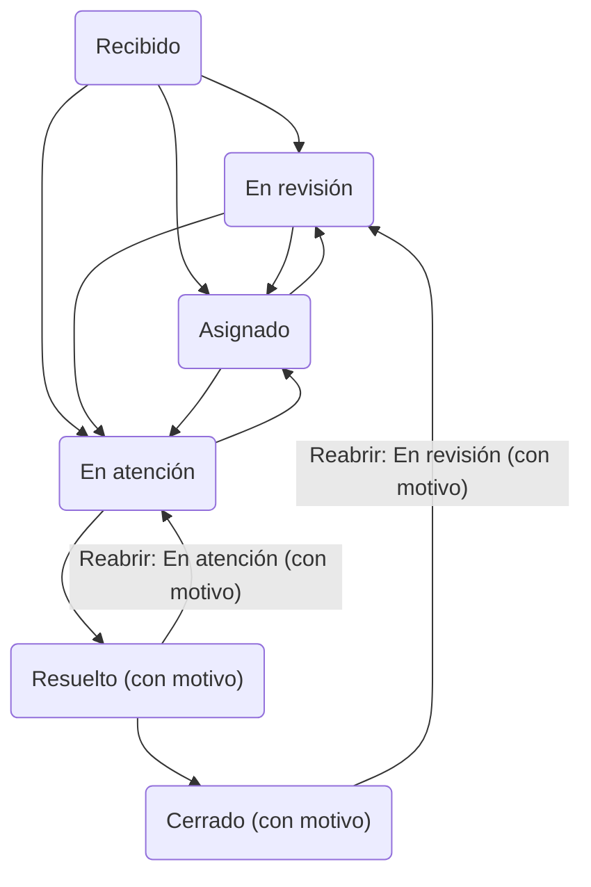

**Qué hay que saber**
- «Resuelto» pide «Cómo se resolvió (justificación)». «Cerrado» pide «Por qué se cierra».
- Reabrir pide «Por qué se reabre». El motivo es interno: la persona no lo ve.
- Lo que la persona lee va en «Mensaje para la persona (opcional)».
- Al asignarlo, un caso «Recibido» o «En revisión» pasa solo a «Asignado». El «No, todavía no» de la persona lo pasa solo a «En atención».

## Los estados: los desvíos
Cuando falta un dato o el caso no se atiende aquí. Se hace en el mismo «Pasar a».

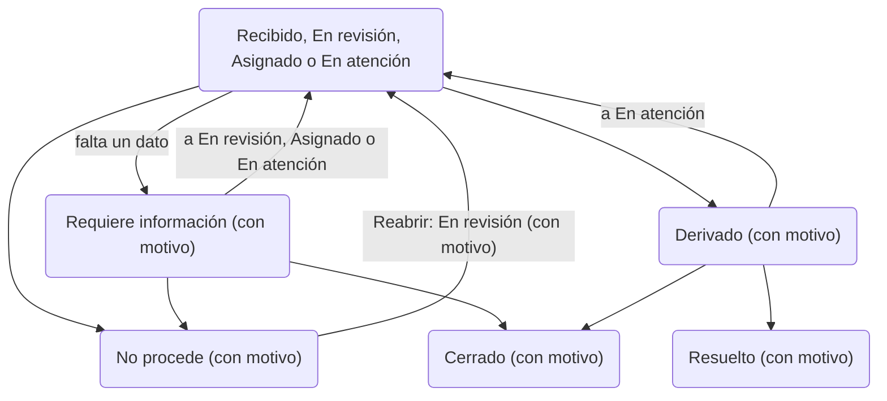

**Qué hay que saber**
- «Requiere información» pide «Qué información necesitas (lo lee la persona)». También se llega con «Escribir» → «Pedir más información».
- «Derivado» pide «A quién se derivó y por qué». «No procede» pide «Por qué no procede».
- Cuando la persona responde, el caso vuelve solo a «En revisión».
- A un caso «Cerrado» o «No procede» la persona ya no le agrega información.

## Casos iguales y apoyos
Los une la coordinación, desde la tarjeta «Casos iguales» del caso.

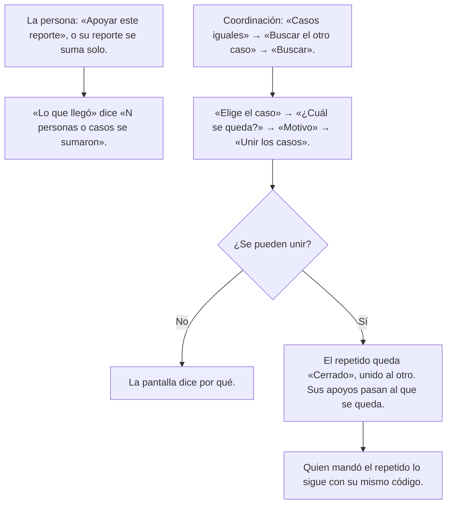

**Qué hay que saber**
- Solo se unen casos del mismo tipo, y los dos abiertos. Las dos historias se guardan.
- Un caso unido dice «Este caso está unido a …: se atiende allí.». Se trabaja en el que se quedó.
- Lo que escribe quien se suma lo lee solo el personal. Quien se suma nunca ve el texto del reporte.

## Spam
Lo marca la coordinación en «Moderación». En una denuncia, también el operador de denuncias.

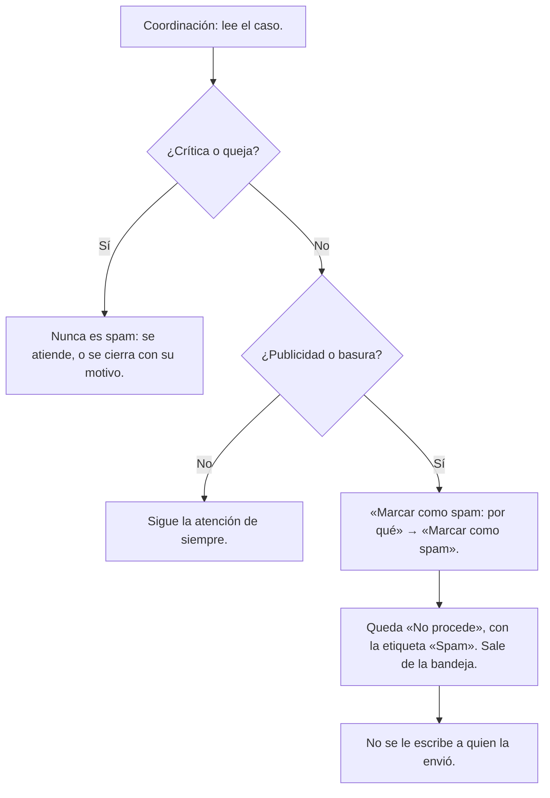

**Qué hay que saber**
- Lo marcado como spam se guarda. Se ve con «Incluir las unidas a otro caso y el spam».
- Un dato que expone a alguien se quita con «Retirar un dato que expone a alguien». La historia guarda qué dato y por qué, nunca lo que decía.

## Los correos que recibe la persona
Los manda la plataforma sola, después de cada paso.

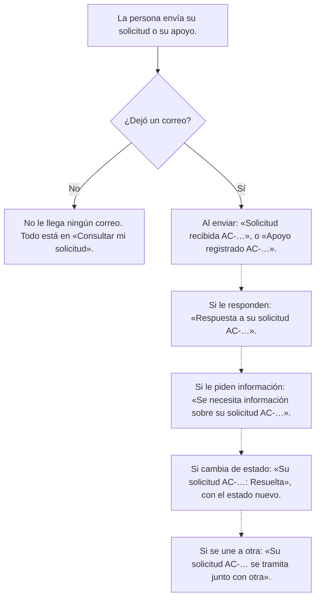

**Qué hay que saber**
- Si eligió «Prefiero que no me contacten», no le llega ninguno. Una nota interna o un caso marcado como spam tampoco mandan correo.
- La respuesta y el pedido de información le llegan solo a quien la envió. El cambio de estado también les llega a quienes se sumaron o mandaron un caso unido, cada uno con su código.
- Cada correo lleva a «Consultar mi solicitud». Nunca lleva la clave ni lo que escribió el personal. Nunca dice «denuncia».
- En la demostración no sale ninguno: quedan en «Ajustes» → «Buzón de correos». Con datos reales, salen cuando el envío de correos esté configurado.

## «Casos atendidos»
Lo publica la coordinación desde el caso, cuando ya está «Resuelto».

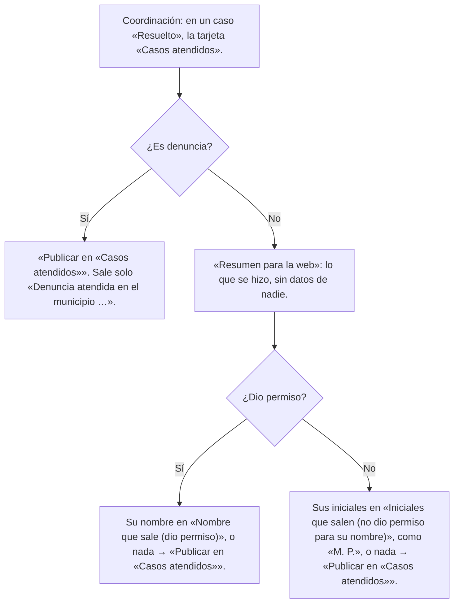

**Qué hay que saber**
- Sale en `/atencion/atendido` y en la portada. Solo de casos resueltos, nunca de uno marcado como spam o unido a otro.
- El permiso lo da la persona en el formulario. Sin él, la base solo acepta iniciales. Una solicitud anónima sale sin nombre ni iniciales.
- «Actualizar la publicación» cambia el texto. «Retirar de «Casos atendidos»» lo quita, con su motivo.
- En la demo con el contenido real no hay casos publicados. La portada no tiene «Casos atendidos».

## Casos vencidos y sin movimiento
Los avisa la plataforma sola, cada mañana, a quienes atienden el caso.

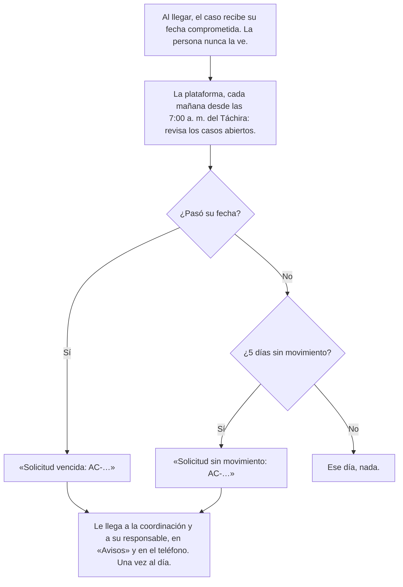

**Qué hay que saber**
- La fecha es el menor entre los días de la categoría y los de la prioridad. Hoy son 15 días. Urgente baja a 2 y Alta a 5.
- Sin responsable, el aviso les llega a los responsables de su área. En una denuncia, a los operadores de denuncias.
- Los 5 días los cambia Administración en «Áreas y plazos». Cuenta como movimiento cualquier cambio o mensaje del caso.
- El aviso dice solo el código. Nunca va por correo. En una denuncia dice «Denuncia vencida» o «Denuncia sin movimiento».

## La web: escribir y enviar a aprobación
Lo hace el editor de la web, en «Web» (`/admin/web`). También pueden el aprobador y el jefe.

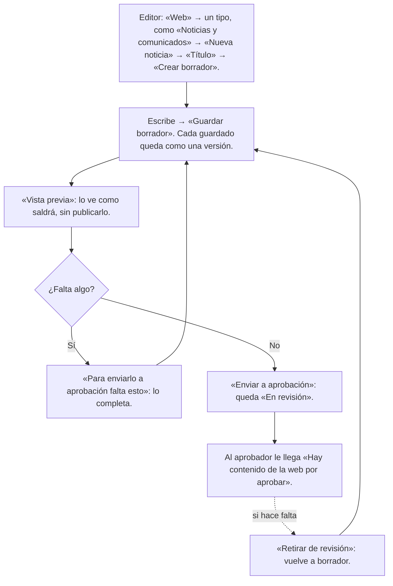

**Qué hay que saber**
- El editor escribe y envía, pero nunca publica.
- Las páginas no se crean: se editan. La portada se arma por bloques.
- Lo que se escribe y no se guarda queda solo en ese teléfono o esa computadora. Solo «Guardar borrador» lo sube.
- Administración lee todo, los borradores también. Nunca escribe ni publica contenido.

## La web: revisar y decidir
Lo hacen el aprobador de la web y el jefe, en «Web» → «Por aprobar».

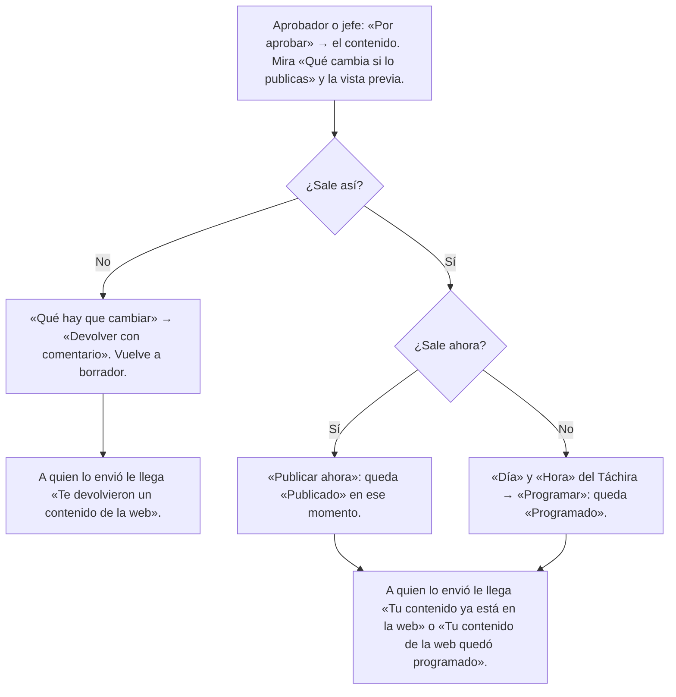

**Qué hay que saber**
- Con «Le falta esto para publicarse», «Publicar ahora» no se puede tocar.
- Se publica exactamente lo que se revisó. Si alguien cambió el borrador mientras tanto, la base no publica.
- Lo que ya está en la web no se programa: sus cambios se publican ahora. «Quitar la programación» devuelve a borrador algo programado.
- El aviso de «Por aprobar» le llega solo al aprobador. El jefe lo ve en la lista.

## La web: cambiar o quitar lo publicado
Para lo que ya está en la web. Archivan el aprobador y el jefe. Volver a una versión lo puede hacer también el editor.

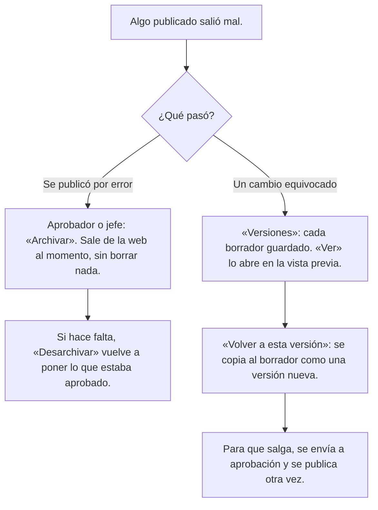

**Qué hay que saber**
- Mientras no se publique otra vez, la web sigue mostrando lo aprobado. La lista dice «Cambios sin publicar».
- En «Versiones», «Borrador actual» y «La publicada» marcan cuál es cuál.
- No hay botón de borrar: lo que sobra se archiva. Un contenido archivado no se cambia hasta desarchivarlo.

## Fotos y documentos
Los sube el editor de la web, en «Web» → «Biblioteca». También pueden el aprobador y el jefe.

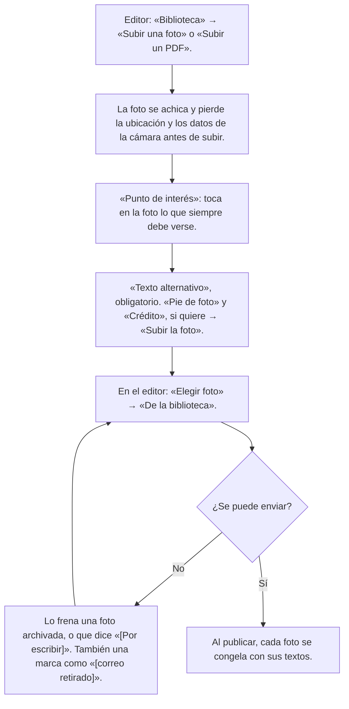

**Qué hay que saber**
- Todo lo que está en la biblioteca es público. Nunca fotos ni archivos de quienes escriben a Atención ciudadana.
- Sin «Texto alternativo», una foto no se sube: la base lo exige. Un PDF pide su «Título del documento».
- En Vercel, cada archivo llega hasta 4 MB.
- Cambiar los textos de una foto no toca lo publicado hasta publicarlo otra vez. «Archivar» la saca de la biblioteca, pero lo publicado la sigue mostrando.

## Ajustes del sitio
Los cambian el aprobador y el jefe, en «Web» → «Ajustes del sitio». También Administración.

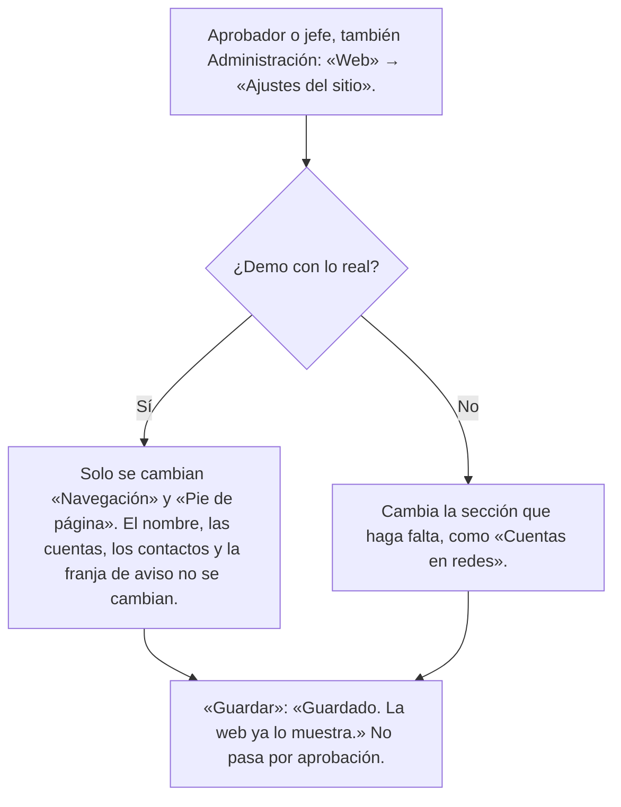

**Qué hay que saber**
- Lo que se guarda aquí sale en la web al momento. Por eso nunca va un dato que nadie confirmó.
- Un contacto sale solo marcado «Verificado». En producción, una cuenta sale solo «Activa» y «Verificada».
- Los «Avisos legales» se ven, pero no se cambian aquí. Son un solo texto de la app.
- El editor de la web no entra a «Ajustes del sitio».

## Direcciones de la web vieja
Las cambian el aprobador y el jefe, en «Web» → «Redirecciones». También Administración.

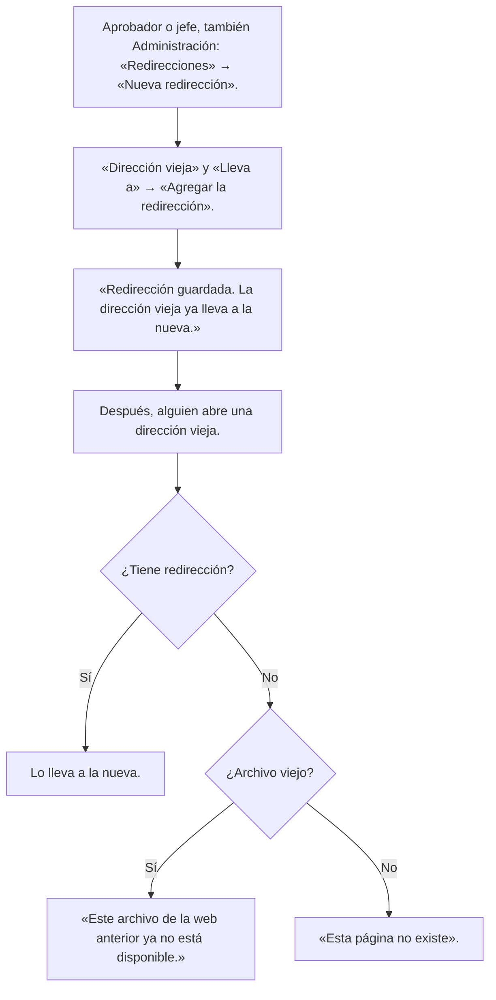

**Qué hay que saber**
- No se redirige una dirección que la web ya usa. Tampoco se hacen dos desde la misma.
- Las del importador dicen «Del importador». Las demás dicen «A mano». El importador nunca las pisa.
- Cuando quien aprueba cambia la «Dirección en la web» de algo publicado, la vieja sigue llevando a la nueva sola.
- Un cambio se nota en la web en más o menos un minuto. Un archivo viejo es uno de `/wp-content/`.

## El contenido real en la demo publicada
Pasa solo, cada vez que Vercel construye la demo publicada (D-101).

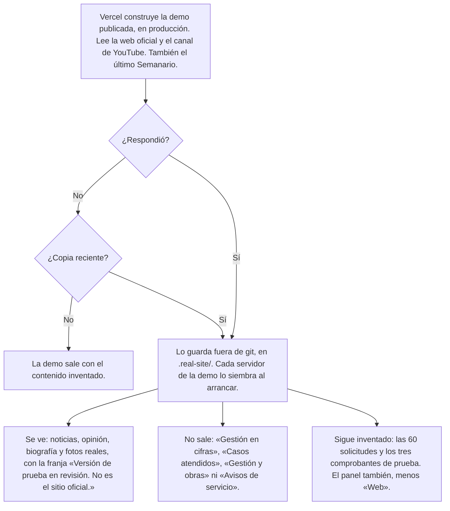

**Qué hay que saber**
- Se apaga con `DATABASE_URL` o con `REAL_SITE_CONTENT=0`. Las pruebas ven siempre lo inventado.
- Trae hasta 48 noticias y 8 de opinión, las más nuevas. Del canal, hasta 12 emisiones. En «Web», cada noticia dice «Traído de la web vieja».
- Una copia sirve si tiene menos de una semana. Si solo YouTube o el Semanario no responden, esa parte sale de la copia.
- El menú tampoco tiene «Gestión y obras». Nadie puede cambiar el nombre ni las cuentas en «Ajustes del sitio»: la demo no debe pasar por la web oficial.
