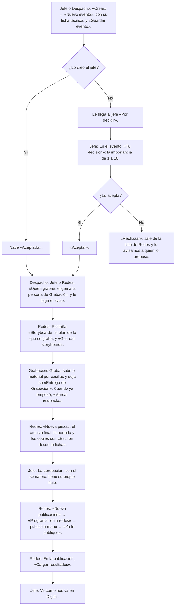
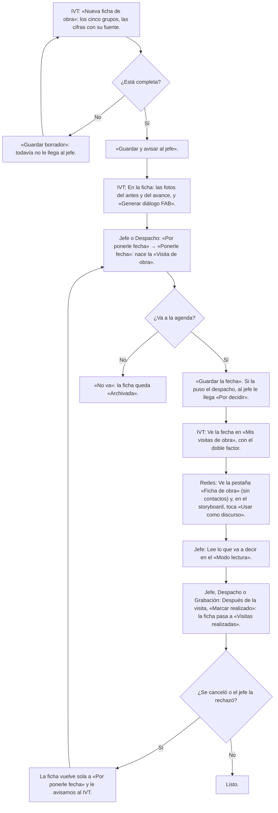
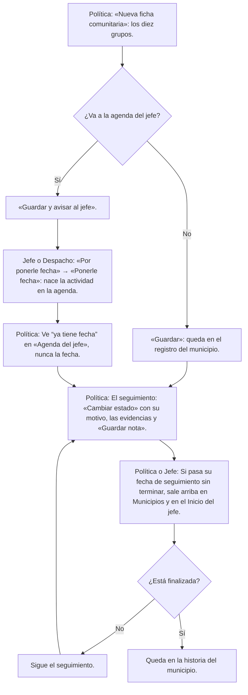
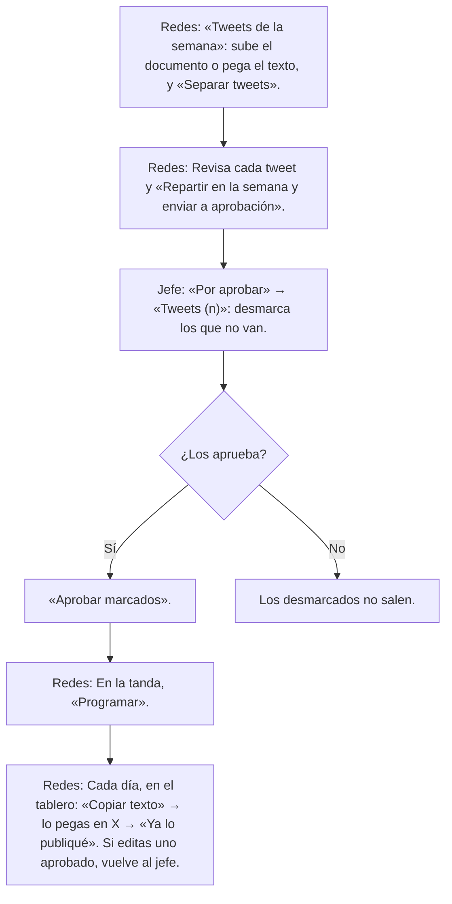
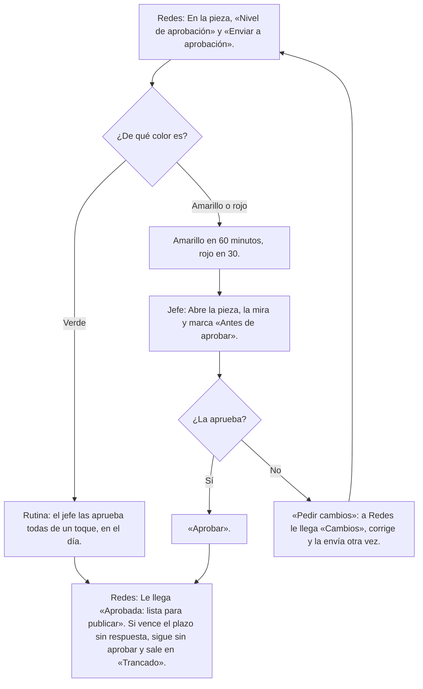
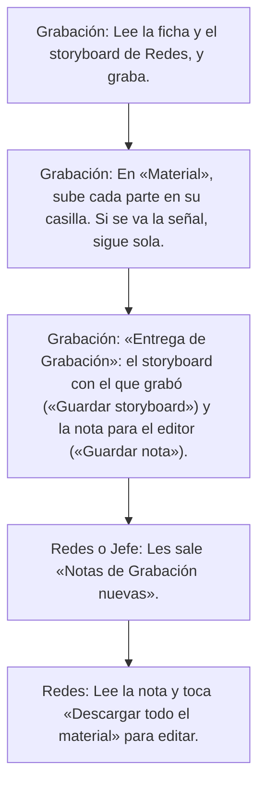
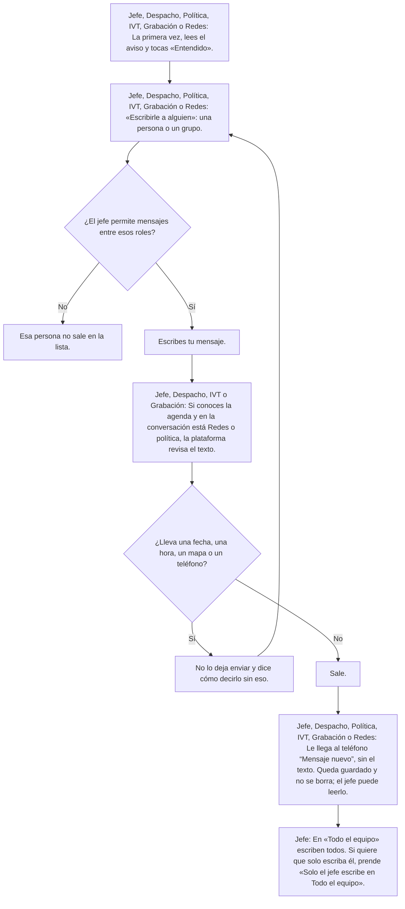
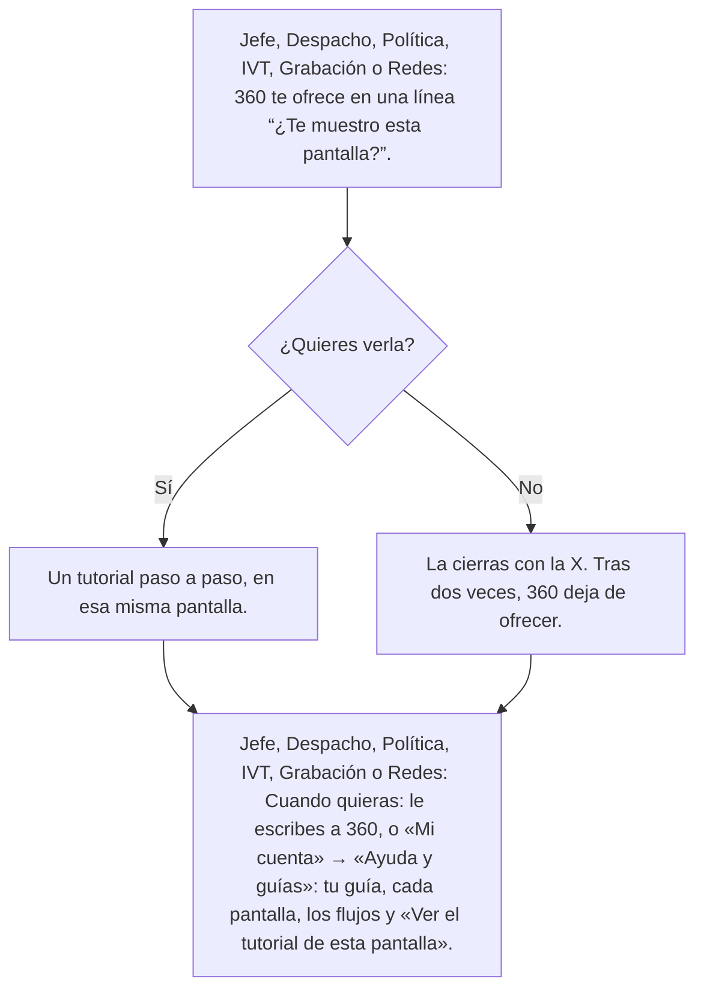

# Flujos: cómo va el trabajo entre todos

> **No se manda todavía: Hillary pidió probar cada rol antes (25/10).**

<!-- Generado por `npm run docs:guides` desde src/lib/guides/ (flows.ts). No se edita a mano: se cambia la fuente y se corre otra vez. -->

Cómo pasa el trabajo de un rol a otro. GitHub dibuja cada diagrama; debajo va el mismo flujo en lista. En la app está en «Mi cuenta» → «Ayuda y guías» → «Cómo va el trabajo entre todos», con «tú» en los pasos de cada quien. Ningún flujo lleva fechas ni horas.

- [Un evento, de la agenda a la publicación](#flujo-evento)
- [Una obra, de la ficha a la visita](#flujo-obra)
- [Un reporte de la comunidad](#flujo-comunitario)
- [Tweets de la semana](#flujo-tweets)
- [El semáforo](#flujo-aprobacion)
- [La entrega de Grabación](#flujo-entrega)
- [Cómo se habla en Mensajes](#flujo-mensajes)
- [Cómo pedir ayuda](#flujo-ayuda)

## Un evento, de la agenda a la publicación
Lo hacen: Jefe, Despacho, Redes y Grabación.

1. **Jefe o Despacho:** «Crear» → «Nuevo evento», con su ficha técnica, y «Guardar evento». (`/agenda/nuevo`)
   ¿Lo creó el jefe?
   - Sí → Nace «Aceptado». Sigue en el paso 3.
   - No → Le llega al jefe «Por decidir».
2. **Jefe:** En el evento, «Tu decisión»: la importancia de 1 a 10. (`/jefe/politica`)
   ¿Lo acepta?
   - Sí → «Aceptar».
   - No → «Rechazar»: sale de la lista de Redes y le avisamos a quien lo propuso.
3. **Despacho, Jefe o Redes:** «Quién graba»: eligen a la persona de Grabación, y le llega el aviso.
4. **Redes:** Pestaña «Storyboard»: el plan de lo que se graba, y «Guardar storyboard». (`/agenda`)
5. **Grabación:** Graba, sube el material por casillas y deja su «Entrega de Grabación». Cuando ya empezó, «Marcar realizado». (`/agenda`)
6. **Redes:** «Nueva pieza»: el archivo final, la portada y los copies con «Escribir desde la ficha». (`/piezas/nueva`)
7. **Jefe:** La aprobación, con el semáforo: tiene su propio flujo. (`/aprobar`)
8. **Redes:** «Nueva publicación» → «Programar en n redes» → publica a mano → «Ya lo publiqué». (`/publicar`)
9. **Redes:** En la publicación, «Cargar resultados». (`/resultados`)
10. **Jefe:** Ve cómo nos va en Digital. (`/jefe/digital`)

## Una obra, de la ficha a la visita
Lo hacen: IVT, Jefe, Despacho, Redes y Grabación.

1. **IVT:** «Nueva ficha de obra»: los cinco grupos, las cifras con su fuente. (`/obras/nueva`)
   ¿Está completa?
   - No → «Guardar borrador»: todavía no le llega al jefe. Sigue en el paso 1.
   - Sí → «Guardar y avisar al jefe».
2. **IVT:** En la ficha: las fotos del antes y del avance, y «Generar diálogo FAB». (`/obras`)
3. **Jefe o Despacho:** «Por ponerle fecha» → «Ponerle fecha»: nace la «Visita de obra». (`/agenda/por-fecha`)
   ¿Va a la agenda?
   - Sí → «Guardar la fecha». Si la puso el despacho, al jefe le llega «Por decidir».
   - No → «No va»: la ficha queda «Archivada».
4. **IVT:** Ve la fecha en «Mis visitas de obra», con el doble factor. (`/agenda`)
5. **Redes:** Ve la pestaña «Ficha de obra» (sin contactos) y, en el storyboard, toca «Usar como discurso».
6. **Jefe:** Lee lo que va a decir en el «Modo lectura».
7. **Jefe, Despacho o Grabación:** Después de la visita, «Marcar realizado»: la ficha pasa a «Visitas realizadas».
   ¿Se canceló o el jefe la rechazó?
   - Sí → La ficha vuelve sola a «Por ponerle fecha» y le avisamos al IVT. Sigue en el paso 3.
   - No → Listo.

## Un reporte de la comunidad
Lo hacen: Política, Jefe y Despacho.

1. **Política:** «Nueva ficha comunitaria»: los diez grupos. (`/reportes/nuevo`)
   ¿Va a la agenda del jefe?
   - No → «Guardar»: queda en el registro del municipio. Sigue en el paso 4.
   - Sí → «Guardar y avisar al jefe».
2. **Jefe o Despacho:** «Por ponerle fecha» → «Ponerle fecha»: nace la actividad en la agenda. (`/agenda/por-fecha`)
3. **Política:** Ve “ya tiene fecha” en «Agenda del jefe», nunca la fecha.
4. **Política:** El seguimiento: «Cambiar estado» con su motivo, las evidencias y «Guardar nota». (`/municipios`)
5. **Política o Jefe:** Si pasa su fecha de seguimiento sin terminar, sale arriba en Municipios y en el Inicio del jefe.
   ¿Está finalizada?
   - No → Sigue el seguimiento. Sigue en el paso 4.
   - Sí → Queda en la historia del municipio.

## Tweets de la semana
Lo hacen: Redes y Jefe.

1. **Redes:** «Tweets de la semana»: sube el documento o pega el texto, y «Separar tweets». (`/tweets/nueva`)
2. **Redes:** Revisa cada tweet y «Repartir en la semana y enviar a aprobación».
3. **Jefe:** «Por aprobar» → «Tweets (n)»: desmarca los que no van. (`/aprobar`)
   ¿Los aprueba?
   - Sí → «Aprobar marcados».
   - No → Los desmarcados no salen.
4. **Redes:** En la tanda, «Programar». (`/tweets`)
5. **Redes:** Cada día, en el tablero: «Copiar texto» → lo pegas en X → «Ya lo publiqué». Si editas uno aprobado, vuelve al jefe.

## El semáforo
Lo hacen: Redes y Jefe.

1. **Redes:** En la pieza, «Nivel de aprobación» y «Enviar a aprobación». (`/redes`)
   ¿De qué color es?
   - Verde → Rutina: el jefe las aprueba todas de un toque, en el día. Sigue en el paso 3.
   - Amarillo o rojo → Amarillo en 60 minutos, rojo en 30.
2. **Jefe:** Abre la pieza, la mira y marca «Antes de aprobar». (`/aprobar`)
   ¿La aprueba?
   - Sí → «Aprobar».
   - No → «Pedir cambios»: a Redes le llega «Cambios», corrige y la envía otra vez. Sigue en el paso 1.
3. **Redes:** Le llega «Aprobada: lista para publicar». Si vence el plazo sin respuesta, sigue sin aprobar y sale en «Trancado». (`/publicar`)

## La entrega de Grabación
Lo hacen: Grabación, Redes y Jefe.

1. **Grabación:** Lee la ficha y el storyboard de Redes, y graba. (`/agenda`)
2. **Grabación:** En «Material», sube cada parte en su casilla. Si se va la señal, sigue sola.
3. **Grabación:** «Entrega de Grabación»: el storyboard con el que grabó («Guardar storyboard») y la nota para el editor («Guardar nota»).
4. **Redes o Jefe:** Les sale «Notas de Grabación nuevas». (`/hoy`)
5. **Redes:** Lee la nota y toca «Descargar todo el material» para editar.

## Cómo se habla en Mensajes
Lo hacen: Jefe, Despacho, Política, IVT, Grabación y Redes.

1. **Jefe, Despacho, Política, IVT, Grabación o Redes:** La primera vez, lees el aviso y tocas «Entendido». (`/mensajes`)
2. **Jefe, Despacho, Política, IVT, Grabación o Redes:** «Escribirle a alguien»: una persona o un grupo. (`/mensajes/nueva`)
   ¿El jefe permite mensajes entre esos roles?
   - No → Esa persona no sale en la lista.
   - Sí → Escribes tu mensaje.
3. **Jefe, Despacho, IVT o Grabación:** Si conoces la agenda y en la conversación está Redes o política, la plataforma revisa el texto.
   ¿Lleva una fecha, una hora, un mapa o un teléfono?
   - Sí → No lo deja enviar y dice cómo decirlo sin eso. Sigue en el paso 2.
   - No → Sale.
4. **Jefe, Despacho, Política, IVT, Grabación o Redes:** Le llega al teléfono “Mensaje nuevo”, sin el texto. Queda guardado y no se borra; el jefe puede leerlo.
5. **Jefe:** En «Todo el equipo» escriben todos. Si quiere que solo escriba él, prende «Solo el jefe escribe en Todo el equipo». (`/mensajes/permisos`)

## Cómo pedir ayuda
Lo hacen: Jefe, Despacho, Política, IVT, Grabación y Redes.

1. **Jefe, Despacho, Política, IVT, Grabación o Redes:** 360 te ofrece en una línea “¿Te muestro esta pantalla?”.
   ¿Quieres verla?
   - Sí → Un tutorial paso a paso, en esa misma pantalla.
   - No → La cierras con la X. Tras dos veces, 360 deja de ofrecer.
2. **Jefe, Despacho, Política, IVT, Grabación o Redes:** Cuando quieras: le escribes a 360, o «Mi cuenta» → «Ayuda y guías»: tu guía, cada pantalla, los flujos y «Ver el tutorial de esta pantalla». (`/ayuda`)
